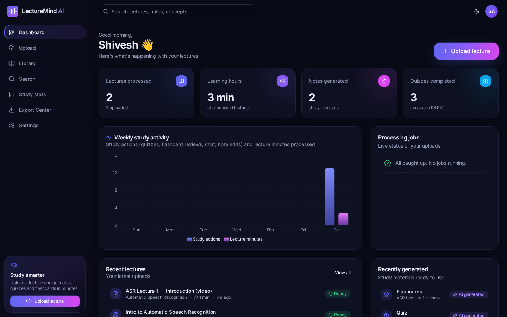
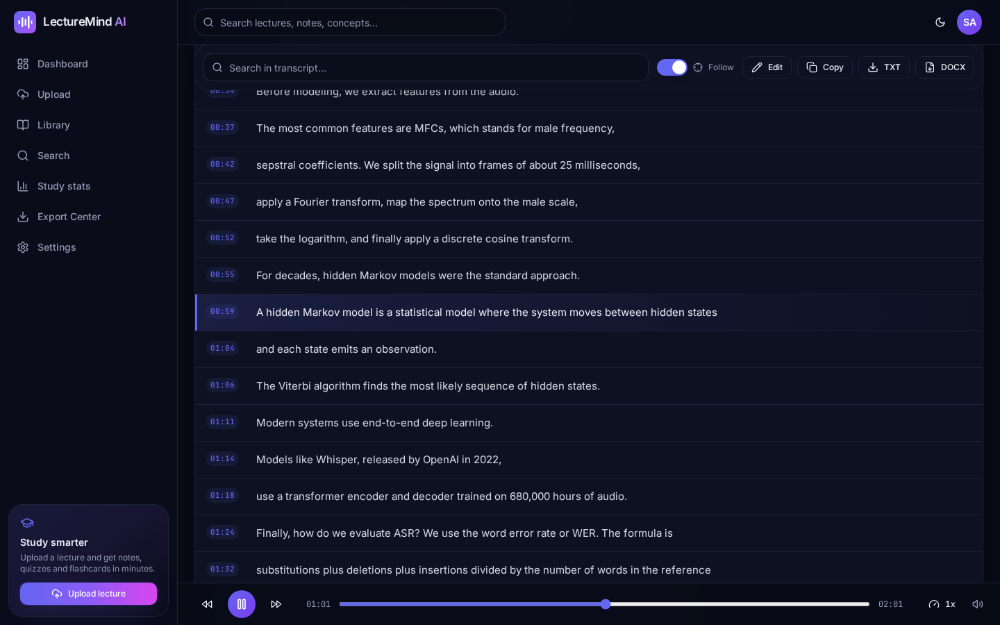
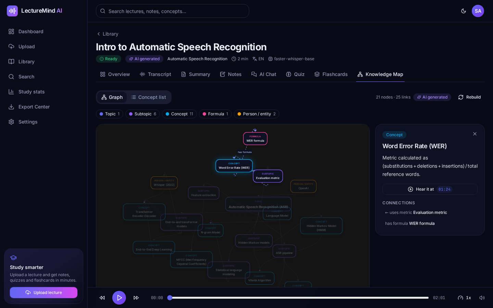
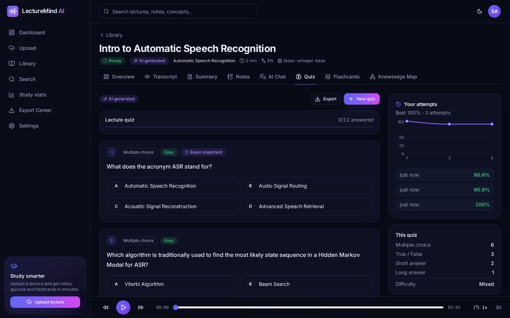
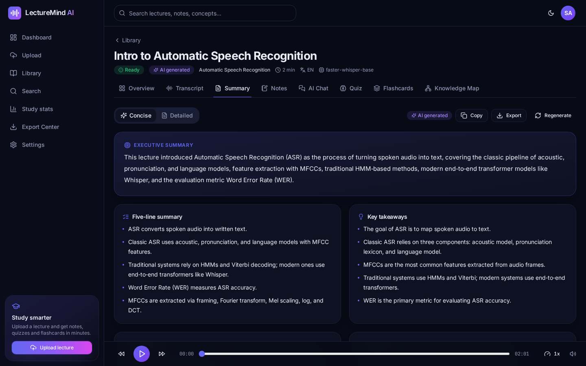
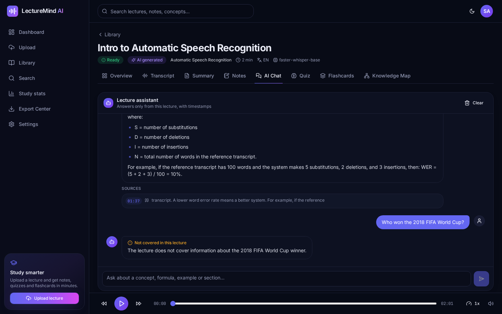
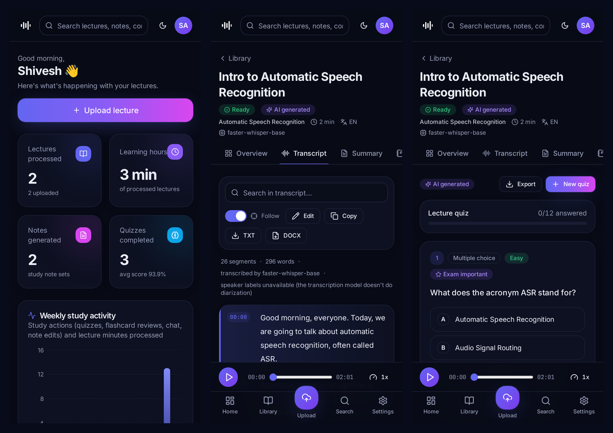

<div align="center">

# 🎙️ LectureMind AI

**Turn every lecture into your personal knowledge base.**

Upload a lecture recording (audio or video) → get a timestamped transcript, summaries, exam-ready notes,
quizzes, flashcards, a knowledge map and a chat assistant that answers *only* from the lecture.

React + TypeScript + Tailwind · FastAPI · MongoDB · Whisper (local or OpenAI) · OpenAI structured outputs · FFmpeg

</div>



| Transcript workspace | Knowledge map | Quiz |
|---|---|---|
|  |  |  |

| Summary | Lecture chat | Mobile |
|---|---|---|
|  |  |  |

> Screenshots are from a real run: a 2-minute ASR lecture was transcribed locally with `faster-whisper base`, and the study material was generated by an LLM through an OpenAI-compatible API.

---

## Contents
1. [Features](#features)
2. [How it works](#how-it-works)
3. [Quick start (local)](#quick-start-local)
4. [Configuration (.env)](#configuration-env)
5. [MongoDB setup](#mongodb-setup)
6. [FFmpeg setup](#ffmpeg-setup)
7. [AI / API keys and demo mode](#ai--api-keys-and-demo-mode)
8. [Privacy: what is sent where](#privacy-what-is-sent-where)
   - [Harsh / threatening language detection](#harsh--threatening-language-detection)
9. [Docker](#docker)
10. [Deployment](#deployment)
11. [Testing](#testing)
12. [API reference](#api-reference)
13. [Project structure](#project-structure)
14. [Scaling the worker](#scaling-the-worker)
15. [Known limitations](#known-limitations)
16. [Troubleshooting](#troubleshooting)

---

## Features

| Area | What you get |
|---|---|
| **Auth** | Register / login / logout, bcrypt password hashing, JWT session in an **httpOnly SameSite cookie** (no token in JS), protected routes, "log out all devices", password change, account and data deletion |
| **Upload** | Drag & drop or file picker, MP3/WAV/M4A/OGG/FLAC/AAC and MP4/MOV/WebM/MKV, type + size validation in the browser **and** server (extension, MIME, and content sniffing with ffprobe), upload progress bar, optional title/subject/description, language selection or auto-detect |
| **Processing pipeline** | Background job queue with persisted per-step status, live progress, retries with backoff for transient AI errors, clear failure messages, resume-from-failed-step, restart recovery. A lecture is **only marked completed when every step succeeded** |
| **Transcript workspace** | Timestamped segments, audio player (seek, ±10 s, speed), click any line or timestamp to seek, **current segment highlighted and auto-followed**, in-transcript search with match navigation, inline editing, copy, TXT/DOCX/SRT export. Speaker labels are shown only if the provider supplies them (Whisper doesn't diarize, so none are invented) |
| **AI summary** | Executive summary, 5-line quick summary, detailed section summary, main topics, arguments, key takeaways, definitions, formulas, examples, timestamped chapters, and a concise/detailed switch |
| **Smart notes** | Structured exam notes (headings, subheadings, bullets, definitions, steps, formulas, examples, pros/cons, terminology, names/dates, revision summary), style presets (exam/concise/detailed), Markdown editor with live preview, export MD/TXT/DOCX/PDF |
| **Lecture chat** | Retrieval-augmented answers grounded in the transcript (embeddings, or BM25 keyword fallback), **source timestamps + excerpts** you can click, and an explicit "the lecture doesn't cover this" answer instead of guessing |
| **Quiz** | MCQ (4 options), true/false, short and long answers, easy/medium/hard/mixed, "exam important" flags, take → submit → score → review explanations → retake, self-marking for written answers, attempt history and score charts |
| **Flashcards** | Flip cards, previous/next, shuffle, rate Easy/Medium/Difficult, review mode (non-easy cards) and hard-only mode, reviewed-card tracking, CSV export, keyboard shortcuts |
| **Knowledge map** | Interactive graph (React Flow + d3-force): topics, subtopics, concepts, definitions, entities, dates, formulas and keywords with labelled relations. Click a node for its explanation, connections and the **timestamp where it was discussed**. An accessible, searchable concept list is provided as an alternative |
| **Global search** | Keyword search across lecture titles, transcripts, notes and concepts, plus **semantic search** over transcript embeddings. Results are grouped by lecture with excerpts and timestamps that deep-link into the transcript, and are always scoped to the signed-in user |
| **Library** | Search, filter by subject / status / date range, sort by newest/oldest/title, rename and edit metadata, delete with confirmation, reprocess failed lectures, quick links to summary and notes |
| **Export Center** | Transcript TXT/DOCX/SRT, summary PDF/DOCX/MD, notes PDF/DOCX/MD/TXT, quiz PDF/DOCX/JSON (with answer key), flashcards CSV, full lecture JSON, all with clear filenames |
| **Content safety** | Every transcript sentence is scanned for **profanity, insults/harassment, threats/violence and hate speech** (English, Hinglish and Tamil-English, incl. disguised spellings like `f*ck` / `sh1t`). A **Safety** tab shows counts, the flagged sentences with severity, masked words (reveal toggle) and click-to-seek timestamps; flagged lines are marked in the transcript; a *Check a sentence* box tests any text live. Optional OpenAI moderation adds context-aware checks. See [below](#harsh--threatening-language-detection) |
| **Dashboard** | Real DB stats (lectures processed, learning hours, notes, quizzes completed, average score), live processing jobs, recent lectures, recently generated materials, and a weekly activity chart |
| **Settings** | Profile, theme (dark/light/system), default language, default note style, password, data deletion, and a read-only AI/system status panel with admin setup instructions. **Keys are never shown** |
| **UX** | Premium dark navy/indigo/violet design, light theme, responsive layout (sidebar on desktop, bottom nav on mobile), skeleton loaders, toasts, empty states, accessible labels and keyboard support |

## How it works

```
 Upload ──► validate (ext, MIME, size, ffprobe sniff) ──► store (per-user folder, random filename)
   │
   ▼  background job (processing_jobs)            each step's status is saved in lectures.steps
 1. extract_audio       FFmpeg → 16 kHz mono WAV (temp) + AAC playback file
 2. transcribe          faster-whisper (local) or OpenAI Whisper API → timestamped segments
 3. process_transcript  clean + sentence-split long segments + chronological chunks (~900 tokens, 1-segment overlap)
 4. embeddings          chunk embeddings (float32, normalised) for semantic search + chat retrieval
 5. summary             MAP: one structured "digest" per chunk  →  hierarchical COMPRESS if still too long
                        →  REDUCE: final summary.   No request ever contains a whole long transcript.
 6. notes               generated from the digests in chronological groups (keeps detail for long lectures)
 7. knowledge_map       nodes + relations from digests, linked to timestamps
 8. quiz                MCQ / TF / short / long, validated (4 options, answer ∈ options, shuffled)
 9. flashcards          Q/A cards, de-duplicated
        └─► lecture.status = "completed" only if all steps completed (or were legitimately skipped)
```

* Every AI output is requested as **JSON validated against a pydantic schema** (`backend/app/schemas/ai.py`), with `response_format=json_schema` (automatic fallback to `json_object`) and one corrective retry on invalid output.
* Prompts tell the model to use **only** the lecture material; chat answers must cite excerpts or say the lecture doesn't cover the question.
* Transient errors (429 rate limits, 5xx, timeouts) are retried by the OpenAI SDK with exponential backoff (`OPENAI_MAX_RETRIES`), then the job is retried (`JOB_MAX_ATTEMPTS`). Permanent errors (corrupt file, no audio, no speech) fail immediately with a clear message.
* Temporary audio is deleted after transcription and on failure.

## Quick start (local)

**Prerequisites:** Python 3.10+ (3.11 recommended), Node.js 18+ (20 recommended), FFmpeg, and MongoDB (local, Docker or Atlas).

```bash
git clone https://github.com/shivesh900/lecturemind-ai.git
cd lecturemind-ai
cp .env.example .env          # Windows: copy .env.example .env  → then edit it
```

**Backend** (terminal 1):

```bash
cd backend
python -m venv .venv
source .venv/bin/activate     # Windows: .venv\Scripts\activate
pip install -r requirements.txt
python -m scripts.init_db     # optional: checks MongoDB and creates indexes (also done on startup)
uvicorn app.main:app --reload --port 8000
```

API docs: http://localhost:8000/docs. The first transcription downloads the Whisper model you configured (~75 MB for `tiny`, ~145 MB for `base`).

**Frontend** (terminal 2):

```bash
cd frontend
npm install
npm run dev
```

Open **http://localhost:5173**, create an account and upload a lecture. In development Vite proxies `/api` to `http://127.0.0.1:8000`, so the session cookie is same-origin.

**Production build of the frontend:** `npm run build` (type-checks with `tsc`, outputs `frontend/dist`), preview with `npm run preview`.

## Configuration (.env)

All settings are environment variables (see [`.env.example`](.env.example)). The backend reads `.env` from the project root or from `backend/`.

| Variable | Default | Purpose |
|---|---|---|
| `MONGODB_URI` | `mongodb://localhost:27017` | Local or Atlas connection string |
| `MONGODB_DB` | `lecturemind` | Database name |
| `JWT_SECRET` | *(placeholder)* | **Set a long random value.** Startup refuses the placeholder when `ENVIRONMENT=production` |
| `COOKIE_SECURE` / `COOKIE_SAMESITE` | `false` / `lax` | Use `true` behind HTTPS |
| `OPENAI_API_KEY` | *(empty)* | Enables AI generation, chat and embeddings. Empty = demo mode |
| `OPENAI_BASE_URL` | *(empty)* | Optional OpenAI-compatible endpoint (Azure OpenAI, local servers, other providers) |
| `OPENAI_CHAT_MODEL` | `gpt-4o-mini` | Model for summaries, notes, quiz, flashcards, map, chat |
| `OPENAI_EMBEDDING_MODEL` | `text-embedding-3-small` | Model for semantic search |
| `TRANSCRIPTION_PROVIDER` | `auto` | `local`, `openai` or `auto` (OpenAI if a key is set, else local) |
| `WHISPER_MODEL` | `base` | Local model size: `tiny`, `base`, `small`, `medium`, `large-v3` |
| `WHISPER_DEVICE` / `WHISPER_COMPUTE_TYPE` | `cpu` / `int8` | Use `cuda` / `float16` on an NVIDIA GPU |
| `MAX_UPLOAD_MB` | `500` | Upload size limit |
| `CHUNK_TARGET_CHARS` | `3500` | Transcript chunk size for the map step (~900 tokens) |
| `LLM_MAX_OUTPUT_TOKENS`, `OPENAI_TIMEOUT_SECONDS`, `OPENAI_MAX_RETRIES` | `4000`, `120`, `4` | Token and retry limits |
| `WORKER_CONCURRENCY`, `JOB_MAX_ATTEMPTS` | `1`, `3` | Background processing |
| `AI_RATE_LIMIT_PER_MINUTE`, `AUTH_RATE_LIMIT_PER_MINUTE` | `12`, `20` | Per-user AI rate limit; per-IP login/register limit |
| `CORS_ORIGINS` | `http://localhost:5173,…` | Comma-separated allowed origins |
| `STORAGE_DIR` | `backend/storage` | Where uploads and playback audio are stored |

## MongoDB setup

Pick one:

* **Docker (easiest):** `docker run -d --name lm-mongo -p 27017:27017 -v lm_mongo:/data/db mongo:7`
* **Local install:** install [MongoDB Community Server](https://www.mongodb.com/try/download/community) (Windows MSI / `brew install mongodb-community` / apt). Default URI `mongodb://localhost:27017` works.
* **MongoDB Atlas (cloud, free tier):** create a cluster → *Database Access*: add a user → *Network Access*: allow your IP (or `0.0.0.0/0` for a hosted backend) → *Connect → Drivers* → copy the `mongodb+srv://…` URI into `MONGODB_URI`.

Collections: `users`, `lectures`, `transcript_segments`, `transcript_chunks` (chunk text + embedding), `summaries`, `study_notes`, `quizzes`, `quiz_attempts`, `flashcards`, `knowledge_maps`, `chat_messages`, `processing_jobs`, `activity`. Indexes are created automatically at startup (`backend/app/core/database.py`) or with `python -m scripts.init_db`. Transcripts are stored one document per segment (no 16 MB document limit, cheap edits); embeddings are stored as compact float32 binary on the chunk documents.

## FFmpeg setup

FFmpeg is required (it extracts audio from video and normalises every upload).

* **Windows:** `winget install Gyan.FFmpeg` (or download from https://www.gyan.dev/ffmpeg/builds/ and add the `bin` folder to PATH). Reopen the terminal and check `ffmpeg -version`.
* **macOS:** `brew install ffmpeg`
* **Ubuntu/Debian:** `sudo apt install ffmpeg`

The Settings page shows whether the server can find FFmpeg.

## AI / API keys and demo mode

* **With `OPENAI_API_KEY`:** all study material is generated by the configured chat model with structured outputs. Embeddings power semantic search and chat retrieval. Transcription uses the OpenAI Whisper API when `TRANSCRIPTION_PROVIDER=openai`/`auto`, or stays local with `TRANSCRIPTION_PROVIDER=local`.
* **Without a key → Demo mode** (clearly labelled with a banner and "Demo mode" badges everywhere):
  * transcription is still **real** (local faster-whisper);
  * summaries are **extractive** (top-ranked transcript sentences), notes are keyword-grouped sentences, the knowledge map is a TF-IDF keyword co-occurrence graph, flashcards and quizzes are built from definition patterns and cloze deletions, and chat returns the most relevant passages instead of composing answers;
  * nothing is ever presented as AI output, and no text is hard-coded.

Keys live only in the server's environment. The browser only ever sees booleans and model names from `/api/system/status`.

## Privacy: what is sent where

* **When `OPENAI_API_KEY` is set, lecture transcripts (text) are sent to OpenAI** (or to the provider at `OPENAI_BASE_URL`) to generate summaries, notes, quizzes, flashcards, knowledge maps, chat answers and embeddings.
* **When `OPENAI_API_KEY` is set and `MODERATION_ENABLED=true`, transcript text is also sent to OpenAI's moderation endpoint** for the harsh-language check. Set `MODERATION_ENABLED=false` to keep that check local (lexicon only).
* **When `TRANSCRIPTION_PROVIDER` resolves to `openai`, the audio itself is sent to OpenAI** for transcription. With `local`, audio never leaves your server.
* Without a key, nothing leaves the server.
* This disclosure is also shown in the app (upload page and settings). Uploaded files are stored under random names in per-user folders, are only read by FFmpeg (never executed), and are deleted with the lecture or account.

## Harsh / threatening language detection

After transcription, a **content-safety** pipeline step scans every transcript segment and stores the result in the `content_safety` collection (one document per lecture: segment index, start/end timestamps, categories, severity, matched terms with character spans, and the source of each flag).

**Categories:** `profanity`, `insult` (insults / harassment), `threat` (threats / violence, incl. incitement to self-harm), `hate`. **Severity:** `low`, `medium`, `high`.

**Two detectors, merged per sentence**

1. **Lexicon (always on, local, free)** – `backend/app/services/content_safety_service.py`
   * A curated list of English, Hinglish (e.g. *chutiya, madarchod, gandu, kamina*) and Tamil-English (e.g. *otha, punda, thevidiya, loosu*) abusive words in transliteration.
   * Word-boundary matching (so *assess*, *class*, *Scunthorpe*, *hello* are **not** flagged), leetspeak and masking tolerance (`f*ck`, `f**k`, `sh1t`, `b!tch`, `fuuuck`).
   * Regex threat patterns: *"I will kill/stab/shoot you"*, *"I'm gonna beat you"*, *"you're dead"*, *"watch your back"*, *"I know where you live"*, *"kill yourself / kys"*, group-hate calls for violence, plus Hinglish (*maar dunga, jaan se maar, khatam kar dunga, dekh lunga*) and Tamil-English (*kolluven, adichiduven*) threats.
   * Threat patterns need a **person as the target**, so technical phrases like *"kill the process"* or *"kill -9"* are not flagged.
2. **AI moderation (optional)** – when `OPENAI_API_KEY` is set and `MODERATION_ENABLED=true`, segments are sent in batches to OpenAI's moderation endpoint (`MODERATION_MODEL`, default `omni-moderation-latest`). Its `harassment`, `harassment/threatening`, `hate`, `hate/threatening` and `violence` scores are mapped onto the same categories (severity: ≥0.85 high, ≥0.6 medium, otherwise low; a category counts when the API flags it or its score ≥ `MODERATION_THRESHOLD`). Each flag is labelled **Lexicon** or **AI moderation** in the UI and API.

**Non-fatal by design:** if the moderation call fails (no network, rate limit, an OpenAI-compatible endpoint without `/moderations`), the lexicon results are kept and the failure is recorded (`moderation.status = "failed"`). A safety-scan error never fails lecture processing.

**When it re-runs:** on processing and reprocessing, automatically after a transcript edit, and on demand with the **Re-scan** button (`POST /api/lectures/{id}/safety/rescan`). Lectures processed before this feature are scanned the first time their Safety tab is opened.

**API**

| Method | Path | Description |
|---|---|---|
| GET | `/api/lectures/{id}/safety` | Summary counts by category and severity + flagged segments with timestamps (ownership-checked) |
| POST | `/api/lectures/{id}/safety/rescan` | Re-scan the current transcript (ownership-checked, AI rate limit) |
| POST | `/api/safety/check` | `{"text": "..."}` (max 2000 chars) → flagged?, categories, severity, matches with spans and masked forms. Auth required, rate-limited (`SAFETY_CHECK_RATE_LIMIT_PER_MINUTE`) |

**Settings**

| Variable | Default | Purpose |
|---|---|---|
| `MODERATION_ENABLED` | `true` | Use OpenAI moderation when a key is set (set `false` to keep everything local) |
| `MODERATION_MODEL` | `omni-moderation-latest` | Moderation model |
| `MODERATION_THRESHOLD` | `0.5` | Minimum category score that counts as a flag |
| `MODERATION_BATCH_SIZE` | `32` | Segments per moderation request |
| `SAFETY_CHECK_RATE_LIMIT_PER_MINUTE` | `30` | Per-user limit for the *Check a sentence* endpoint |

**Honest limits**

* A word list **cannot understand context, sarcasm, quotes or intent**. A lecturer quoting an insult, a history lecture about violence, or a sports-style *"we will beat you"* can be flagged, and new slang or creative spellings can be missed. Treat flags as pointers for review, not verdicts.
* Transliterated Hindi/Tamil has many spellings; the lexicon covers common ones only. Extend `_LEXICON` / `_PHRASES` in `content_safety_service.py` for your context.
* Speech recognition can mishear or soften swear words, so the scan is only as good as the transcript.
* AI moderation needs an `OPENAI_API_KEY`, and **transcript text is then sent to OpenAI** for moderation. With no key (or `MODERATION_ENABLED=false`) the check is fully local.

## Docker

```bash
cp .env.example .env    # set JWT_SECRET (and OPENAI_API_KEY if you have one)
docker compose up --build
```

Open http://localhost:8080. This starts **MongoDB**, the **backend** (with FFmpeg and the Whisper `base` model baked in) and the **frontend** (nginx serving the build and proxying `/api` to the backend).

## Deployment

A setup that works on free/cheap tiers:

1. **Database:** MongoDB Atlas (free M0 cluster). Allow the backend's IPs (or `0.0.0.0/0`).
2. **Backend:** [Render](https://render.com) or [Railway](https://railway.app) using `backend/Dockerfile` (a `render.yaml` blueprint is included). Set `ENVIRONMENT=production`, `MONGODB_URI`, `JWT_SECRET`, `OPENAI_API_KEY`, `COOKIE_SECURE=true`, `CORS_ORIGINS=https://your-frontend.vercel.app`, and attach a persistent disk at `/data/storage`. Local Whisper needs ≥1 GB RAM for `base` (use `tiny` on the smallest plans, or `TRANSCRIPTION_PROVIDER=openai`).
3. **Frontend:** [Vercel](https://vercel.com). Set the root directory to `frontend`, build with `npm run build`, output `dist`. Edit `frontend/vercel.json` and replace `YOUR-BACKEND.onrender.com` with your backend URL. The rewrite keeps `/api` **same-origin**, so the secure session cookie works without third-party-cookie problems.

## Testing

```bash
cd backend
pip install -r requirements-dev.txt
pytest -q                       # 82 tests, ~20 s (downloads Whisper tiny once, ~75 MB)
pytest -q -m "not slow"         # skip the tests that run real Whisper
TEST_MONGODB_URI=mongodb://localhost:27017 pytest -q   # run against a real MongoDB instead of the in-memory mock
```

* **No paid APIs are called.** AI tests inject a fake LLM client that returns schema-valid objects. MongoDB is replaced by `mongomock-motor` unless `TEST_MONGODB_URI` is set.
* Coverage: authentication, file validation (incl. a fake "mp3" that is really text), audio extraction from a generated MP4, **real speech transcription with Whisper tiny**, transcript cleaning/chunking, OpenAI-transcriber piece offsets (mocked), map-reduce summary (one map call per chunk, no giant prompt), hierarchical compression, notes, quiz normalisation, flashcards, knowledge-map sanitising, LLM JSON retry, chat refusal, ownership on every lecture endpoint, scoped search, all export formats, failed jobs (permanent vs retried, never marked completed, resume after recovery), rate limiting, library filters, quiz grading, data deletion, and **content safety** (clean text, profanity, leetspeak, threat patterns, false-positive guards like *assess/class/Scunthorpe/kill the process*, Hinglish/Tamil-English, moderation merge and failure with a mocked client, safety endpoints, ownership, re-scan on transcript edit).
* **Audio fixture:** `backend/tests/fixtures/speech_sample.wav` is a ~8 s real speech clip generated with espeak-ng. Regenerate it with `backend/tests/fixtures/make_fixture.sh` (needs `espeak-ng` + `ffmpeg`), or record yourself reading *"Speech recognition converts spoken language into text. The acoustic model and the language model work together."* and save it as 16 kHz mono WAV with that name.
* Frontend: `cd frontend && npm run build` runs a strict TypeScript check and a production build.

## API reference

Interactive docs at `/docs`. Errors use one JSON shape: `{"error": {"code", "message", "details"}}`.

| Method | Path | Description |
|---|---|---|
| POST | `/api/auth/register` · `/api/auth/login` · `/api/auth/logout` | Account and session (cookie + bearer token in response) |
| GET | `/api/auth/me` | Current user |
| PATCH/DELETE | `/api/users/me` · POST `/api/users/me/password` · DELETE `/api/users/me/data` | Profile, preferences, password, data deletion |
| POST | `/api/lectures/upload` | Multipart upload (`file`, `title`, `subject`, `description`, `language`) → starts processing |
| GET | `/api/lectures` | List with `q`, `subject`, `status`, `date_from`, `date_to`, `sort` |
| GET/PATCH/DELETE | `/api/lectures/{id}` | Read / edit metadata / delete (with all data and files) |
| POST | `/api/lectures/{id}/reprocess` | Resume failed steps (`?full=true` for everything) |
| GET | `/api/lectures/{id}/status` | Status, progress, per-step state, job |
| GET | `/api/lectures/{id}/media` | Playback audio (supports range requests for seeking) |
| GET/PATCH | `/api/lectures/{id}/transcript` · GET `/transcript/search?q=` | Transcript, edit segments, search |
| GET/POST | `/api/lectures/{id}/summary` | Read / regenerate (async) |
| GET/POST/PATCH | `/api/lectures/{id}/notes` | Read / regenerate with style (async) / save edits |
| GET/POST | `/api/lectures/{id}/knowledge-map` | Read / rebuild (async) |
| GET | `/api/lectures/{id}/quizzes` | Quizzes + attempts for a lecture |
| POST | `/api/lectures/{id}/quiz` | Generate a quiz (`difficulty`, `num_mcq`, `num_true_false`, `num_short`, `num_long`) |
| GET/DELETE | `/api/quizzes/{quiz_id}` · POST/GET `/api/quizzes/{quiz_id}/attempts` · GET `/api/attempts` | Take, score and track quizzes |
| GET/POST | `/api/lectures/{id}/flashcards` · POST `/flashcards/{card_id}/review` | Cards, regenerate, rate |
| GET/POST/DELETE | `/api/lectures/{id}/chat` | History, ask, clear |
| GET | `/api/lectures/{id}/export/{transcript\|summary\|notes\|quiz\|flashcards\|json}?format=` | Downloads |
| GET/POST | `/api/lectures/{id}/safety` · POST `/safety/rescan` · POST `/api/safety/check` | Harsh / threatening language report, re-scan, ad-hoc sentence check |
| GET | `/api/search?q=&mode=hybrid\|keyword\|semantic` | Global search (user-scoped) |
| GET | `/api/dashboard/stats` · `/api/dashboard/activity?days=7&tz_offset_minutes=330` | Dashboard data |
| GET | `/api/system/status` · `/api/system/health` | Non-secret configuration status / health |

Every lecture-scoped route checks ownership; another user's lecture returns **404** (ids are not revealed). Generation and chat routes are rate-limited per user.

## Project structure

```
lecturemind-ai/
├── backend/
│   ├── app/
│   │   ├── api/          auth, users, lectures, transcript, ai (summary/notes/quiz/flashcards/map/chat), exports, dashboard, search, system, deps
│   │   ├── core/         config (env), database (motor + indexes), security (bcrypt/JWT), rate_limit, errors, logging (secret redaction)
│   │   ├── models/       document helpers, pipeline step definitions
│   │   ├── schemas/      request schemas + AI output schemas (pydantic)
│   │   ├── services/     audio_extractor, transcription_service, transcript_processor, llm_client, summarization_service,
│   │   │                 notes_generator, quiz_generator, flashcard_generator, knowledge_extractor, embedding_service,
│   │   │                 retrieval_service, lecture_chat_service, export_service, demo_extractor, storage_service
│   │   ├── workers/      queue (background jobs, retries, recovery), pipeline (the processing steps)
│   │   ├── utils/        file validation, text helpers
│   │   └── main.py
│   ├── scripts/init_db.py
│   ├── tests/            pytest suite + fixtures/speech_sample.wav
│   ├── requirements.txt, requirements-dev.txt, Dockerfile, pytest.ini
├── frontend/
│   ├── src/
│   │   ├── components/   ui/ (shadcn-style: button, card, dialog, select, tabs, …), Logo, Waveform, ProcessingSteps, Markdown, …
│   │   ├── layouts/      AppLayout (sidebar, top bar, mobile bottom nav, protected route)
│   │   ├── pages/        Landing, Auth, Dashboard, Upload, Library, Search, Study, ExportCenter, Settings,
│   │   │                 lecture/ (Workspace + Overview, Transcript, Summary, Notes, Chat, Quiz, Flashcards, Knowledge tabs)
│   │   ├── hooks/        useAuth, useTheme, useApi, useSystemStatus
│   │   ├── services/     api client (cookie auth, upload progress, downloads)
│   │   ├── types/  utils/
│   ├── package.json, vite.config.ts, tailwind.config.js, Dockerfile, nginx.conf, vercel.json
├── docs/screenshots/
├── docker-compose.yml, render.yaml, .env.example, .gitignore
```

## Scaling the worker

The default queue runs inside the API process (simple, no extra services): jobs are persisted in `processing_jobs`, so a restart re-queues unfinished work. To scale out:

* **Celery / RQ:** the pipeline has no dependency on the queue. Create a task that calls `await run_job(job_id)` (`app/workers/queue.py`), make `JobQueue.enqueue` push the job id to Redis instead of the asyncio queue, and run workers with the same `.env`.
* **Rate limiting** is in-memory per process; for multiple API replicas move `RateLimiter` to Redis (same `hit()` interface).
* **Vector search:** embeddings are compared in-process with NumPy, which is fast for a student's library. For large deployments, store them as arrays and use MongoDB Atlas Vector Search.

## Known limitations

* **Speaker diarization** is not available (Whisper/faster-whisper don't provide it), so no speaker labels are shown. The UI supports labels if a diarizing provider is added.
* Local Whisper on CPU runs at roughly 5–10× real time with `base` on a modern 4-core CPU (a 1-hour lecture takes about 6–12 minutes). Use a GPU (`WHISPER_DEVICE=cuda`) or `TRANSCRIPTION_PROVIDER=openai` for faster turnaround.
* Accuracy depends on audio quality and model size; heavy accents, jargon or noisy rooms benefit from `small`/`medium`. Edit the transcript and regenerate materials if needed.
* AI output quality depends on the chosen model; all generation is grounded in the transcript, but always double-check important facts against the lecture.
* Editing the transcript updates chat/search text immediately, but summaries/notes/quiz are only refreshed when you click *Regenerate*.
* Harsh-language detection without a key uses a word/phrase list, which misses context and sarcasm (see [above](#harsh--threatening-language-detection)).
* Demo mode (no key) produces simple extractive material by design. It is meant to show the pipeline, not to replace the AI features.
* The in-process queue is meant for a single API instance (see *Scaling the worker*).

## Troubleshooting

| Problem | Fix |
|---|---|
| `FFmpeg is not installed on the server` | Install FFmpeg and make sure `ffmpeg -version` works in the same terminal that runs uvicorn |
| `ServerSelectionTimeoutError` | MongoDB isn't running or `MONGODB_URI` is wrong (Atlas: check Network Access) |
| Upload rejected as "could not be read" | The file isn't valid audio/video (or is corrupt). Re-export it as MP3/MP4 |
| Stuck on *Transcribing* the first time | The Whisper model is downloading (once). Check the backend logs |
| AI steps fail with 401/429 | Check `OPENAI_API_KEY`, billing and rate limits. The job retries automatically, then use *Retry processing* |
| Logged out immediately in production | Serve over HTTPS with `COOKIE_SECURE=true`, and keep `/api` same-origin (the Vercel rewrite) |

---

Built as an **Automatic Speech Recognition** course project. MIT License.
